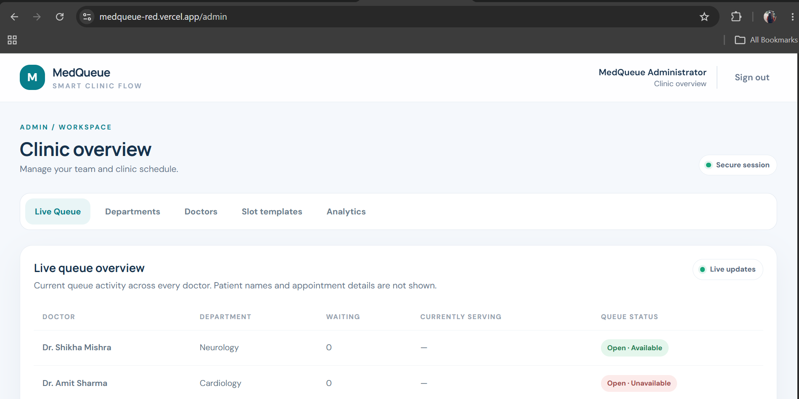
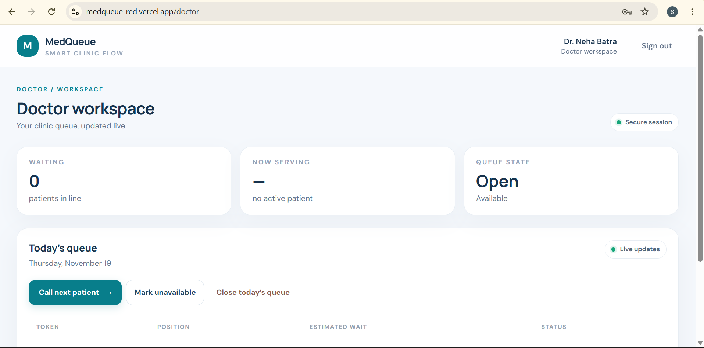
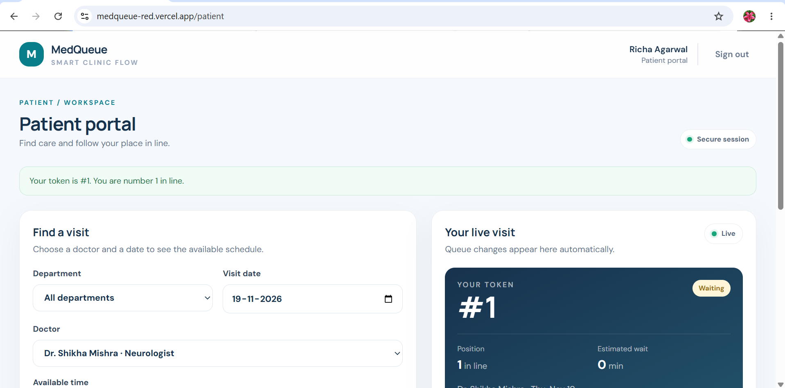
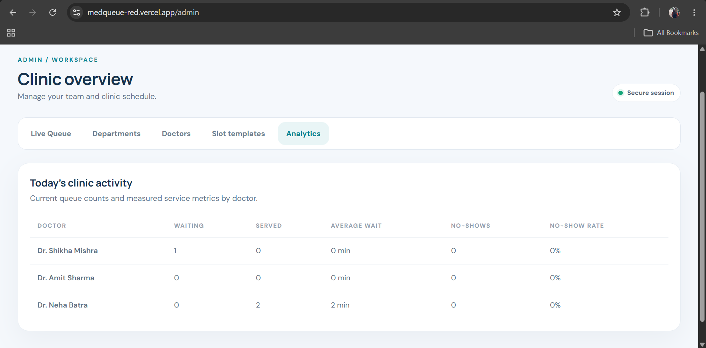
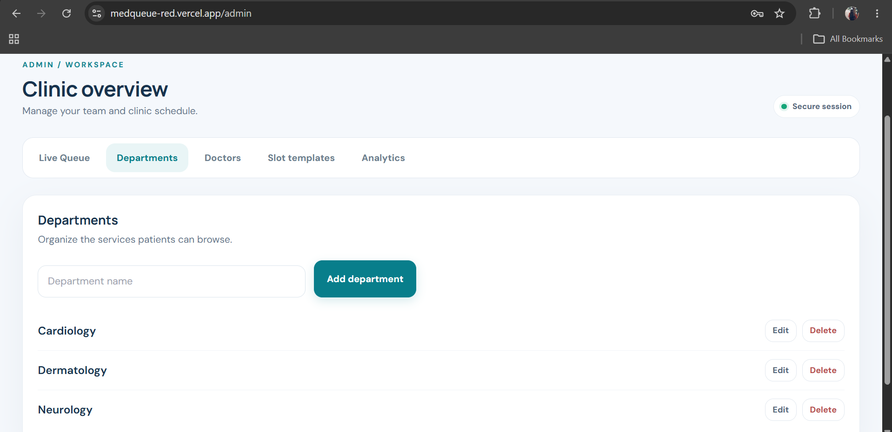
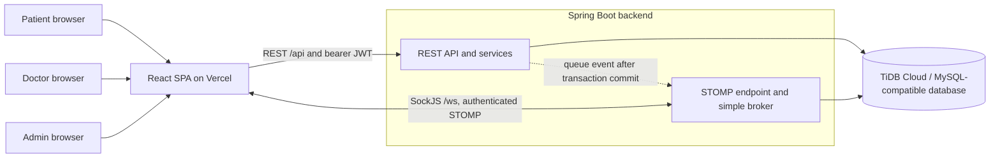

# MedQueue — Smart Clinic Flow

MedQueue is a clinic appointment and queue management application. Patients can find doctors, book appointments or join a walk-in queue, doctors can manage the day's visits, and administrators can maintain clinic services and review queue activity.

[](https://react.dev/)
[](https://spring.io/projects/spring-boot)
[](https://openjdk.org/)
[](https://www.mysql.com/)

**Live application:** [medqueue-red.vercel.app](https://medqueue-red.vercel.app) · [Source code](https://github.com/swatipathak770/MedQueue)

## Table of contents

- [Project overview](#project-overview)
- [Live demo](#live-demo)
- [Application screenshots](#application-screenshots)
- [Features](#features)
- [Technology stack](#technology-stack)
- [System architecture](#system-architecture)
- [Database design](#database-design)
- [Authentication and security](#authentication-and-security)
- [API overview](#api-overview)
- [Project structure](#project-structure)
- [Local installation and setup](#local-installation-and-setup)
- [Environment variables](#environment-variables)
- [Deployment](#deployment)
- [Planned enhancements](#planned-enhancements)
- [Author](#author)

## Project overview

Clinics often coordinate appointments and walk-ins across separate schedules, while patients have limited visibility into their place in line. MedQueue provides a shared workflow for clinic administrators, doctors, and patients.

Patients browse the public doctor directory and available appointment slots, then book a slot or request a walk-in visit. Each appointment receives a token for its doctor and date. Doctors view and advance their daily queue, while administrators maintain departments, doctor profiles, and recurring slot templates and can review clinic-wide queue and analytics summaries.

The frontend loads queue data through REST APIs and receives subsequent changes over an authenticated STOMP connection. The backend publishes a queue snapshot after a queue-changing transaction commits. The current broker is Spring's in-memory simple broker, so the documented implementation supports a single backend instance without shared broker infrastructure. Queue snapshots expose queue information rather than patient names or email addresses.

## Live demo

| Resource | Link |
|---|---|
| Frontend | [https://medqueue-red.vercel.app](https://medqueue-red.vercel.app) |
| Backend | [https://medqueue-e3yw.onrender.com](https://medqueue-e3yw.onrender.com) |
| Backend health | [https://medqueue-e3yw.onrender.com/actuator/health](https://medqueue-e3yw.onrender.com/actuator/health) |
| GitHub repository | [swatipathak770/MedQueue](https://github.com/swatipathak770/MedQueue) |

The backend's health endpoint is exposed through Spring Boot Actuator. If the service is running on Render's Free compute plan, Render spins an idle web service down after 15 minutes without inbound HTTP requests or WebSocket messages; the next request can take about a minute while the service starts. See [Render's free web service documentation](https://render.com/docs/free).

## Application screenshots

### Admin dashboard



Administrators can review queue counts and the current serving state across doctors.

### Doctor dashboard



Doctors see their waiting count, currently serving token, queue availability, and daily queue controls.

### Patient portal



Patients can browse doctors and appointment availability and follow a booked visit's token and queue position.

### Admin analytics



The analytics view summarizes daily waiting and served counts, average wait, and no-show metrics by doctor.

### Department management



Administrators can add, rename, and remove the departments available in the clinic directory.

## Features

### Administrator

- Create, update, and delete departments.
- Create, update, and delete doctor accounts and profiles.
- Manage recurring weekly slot templates and capacities.
- Review a clinic-wide live queue overview without patient names or appointment details.
- View daily per-doctor analytics, including waiting and served counts, average wait, and no-show metrics.

The analytics service counts `SKIPPED` visits as no-shows when calculating the no-show count and rate.

### Doctor

- View the current day's queue and estimated waits.
- Call the next waiting patient when the queue is open and no other visit is active.
- Complete a called or in-progress visit.
- Skip a waiting or called visit; skipped visits are recorded with the `SKIPPED` status.
- Set availability and close or reopen today's queue.

### Patient

- Browse departments and doctors.
- View a doctor's available slots for a selected date.
- Book an appointment slot or join the walk-in queue.
- Track the appointment token, current position, and estimated wait.
- View personal appointment history and authorized status history.

## Technology stack

| Area | Technologies |
|---|---|
| Frontend | React 19, Vite 6, React Router 7, Redux Toolkit 2, Axios, Tailwind CSS 3 |
| Backend | Java 17, Spring Boot 3.5, Spring MVC, Spring Data JPA, Hibernate, Bean Validation |
| Database | MySQL-compatible SQL; MySQL Connector/J; TiDB Cloud is the documented hosted database target |
| Schema migrations | Flyway 11, including MySQL and TiDB database modules |
| Authentication | Spring Security, JWT (JJWT 0.12.6), BCrypt password encoder |
| Real-time communication | Spring WebSocket/STOMP, SockJS, `@stomp/stompjs`; Spring in-memory simple broker |
| API documentation and health | springdoc-openapi 2.8, Spring Boot Actuator |
| Development and packaging | Maven Wrapper, npm, Docker, Docker Compose, Vitest |
| Deployment configuration | Vercel frontend, Render backend, TiDB Cloud database target |

## System architecture



The React single-page application provides role-specific workspaces and uses Axios for REST requests. The Spring Boot backend separates controllers, services, repositories, and persistence entities; it validates requests, enforces role and ownership rules, manages transactions, and reads or writes the relational database. The STOMP endpoint sends queue snapshots to authorized subscribers after relevant database changes commit.

The repository documents Vercel, Render, and TiDB Cloud as the hosted arrangement. TiDB's compatibility with the migrations and Hibernate validation should be confirmed against the selected cluster version before migrating or using production data; see the [deployment guide](docs/DEPLOYMENT_VERCEL_RENDER_TIDB.md).

## Database design

Flyway migrations define the schema. Hibernate is configured with `ddl-auto=validate`, so it checks the schema at startup rather than creating or updating tables. The schema is MySQL-compatible and includes these tables:

| Table | Purpose and relationships |
|---|---|
| `users` | User identity, unique email, password hash, role (`ADMIN`, `DOCTOR`, or `PATIENT`), optional phone, and creation time. |
| `departments` | Unique department names. |
| `doctors` | Doctor profile linked one-to-one to a user and many-to-one to a department; stores specialization, average consultation duration, and availability. |
| `slots` | Recurring day-of-week schedule and capacity; each slot belongs to a doctor. |
| `appointments` | Patient, doctor, date, token, status, timestamps, and optional slot. A `NULL` slot represents a walk-in. Tokens are unique per doctor and appointment date. |
| `queue_states` | Per-doctor, per-date open state and latest called token; one row per doctor and date. |
| `appointment_status_history` | Initial and subsequent status entries associated with an appointment, timestamp, and actor identifier. |

Foreign keys connect doctors to users and departments; slots and queue states to doctors; appointments to patients, doctors, and optional slots; and status history to appointments. `V1__initial_schema.sql` creates the first six tables and `V2__appointment_status_history.sql` adds the status audit table and index. Each booking records an initial `WAITING` status entry, and supported doctor queue transitions append audit entries in their transaction. The actor identifier stores a user ID rather than an email address. Booking and queue updates are transactional; doctor-level locking and a unique token constraint protect token allocation and queue advancement.

## Authentication and security

- Registration creates patient accounts. Doctor accounts are provisioned through administrator workflows; an optional bootstrap configuration can create the first administrator.
- Login issues a signed JWT. Protected REST requests send it as `Authorization: Bearer <token>`; the frontend stores the token in browser local storage and attaches it to API requests.
- Spring Security is stateless and uses BCrypt to hash passwords. Method-level authorization checks roles, while service logic also checks ownership for doctor queue actions and appointment status history.
- CORS is configured with explicit allowed origins. The production profile exposes only the Actuator health endpoint and disables Swagger/OpenAPI.
- STOMP `CONNECT` requires a valid bearer JWT. Queue subscriptions are restricted by role and ownership: doctors can subscribe to their own queue, patients need an eligible appointment for that doctor, and administrators can subscribe to clinic queues. Clients cannot publish queue messages.
- Authentication endpoints have configurable in-memory rate limits. Because the limiter and STOMP broker are instance-local, they do not provide shared state across multiple backend instances.

## API overview

All REST paths are rooted at `/api` unless shown otherwise. Protected REST endpoints require a bearer JWT. The endpoint mappings below are defined in the backend controllers.

| Method | Path | Access | Purpose |
|---|---|---|---|
| `POST` | `/api/auth/register` | Public | Register a patient account. |
| `POST` | `/api/auth/login` | Public | Authenticate and return a JWT. |
| `GET` | `/api/departments` | Public | List departments. |
| `GET` | `/api/doctors?department={name}` | Public | List doctors, optionally filtered by department. |
| `GET` | `/api/doctors/{id}/slots?date=YYYY-MM-DD` | Public | List slots and remaining capacity for a date. |
| `POST` | `/api/appointments` | `PATIENT` | Book a slot or create a walk-in appointment. |
| `GET` | `/api/appointments/me` | `PATIENT` | List the authenticated patient's appointments. |
| `GET` | `/api/appointments/{id}/status-history` | Authorized patient, assigned doctor, or `ADMIN` | Read an appointment's status audit. |
| `GET` | `/api/doctor/queue` | `DOCTOR` | Get the doctor's queue for today. |
| `POST` | `/api/doctor/queue/next` | `DOCTOR` | Call the next waiting patient. |
| `POST` | `/api/doctor/queue/{id}/complete` | `DOCTOR` | Complete a called or in-progress visit. |
| `POST` | `/api/doctor/queue/{id}/skip` | `DOCTOR` | Skip a waiting or called visit. |
| `PUT` | `/api/doctor/queue/availability` | `DOCTOR` | Set doctor availability. |
| `POST` | `/api/doctor/queue/close` | `DOCTOR` | Close today's queue. |
| `POST` | `/api/doctor/queue/reopen` | `DOCTOR` | Reopen today's closed queue. |
| `POST` | `/api/admin/departments` | `ADMIN` | Create a department. |
| `PUT`, `DELETE` | `/api/admin/departments/{id}` | `ADMIN` | Update or delete a department. |
| `GET`, `POST` | `/api/admin/doctors` | `ADMIN` | List and create doctor accounts/profiles. |
| `PUT`, `DELETE` | `/api/admin/doctors/{id}` | `ADMIN` | Update or delete a doctor profile. |
| `GET`, `POST` | `/api/admin/slots` | `ADMIN` | List and create weekly slot templates. |
| `PUT`, `DELETE` | `/api/admin/slots/{id}` | `ADMIN` | Update or delete a slot template. |
| `GET` | `/api/admin/queues` | `ADMIN` | View today's queue summary across doctors. |
| `GET` | `/api/admin/analytics` | `ADMIN` | View today's per-doctor analytics. |

### WebSocket and STOMP

- SockJS/STOMP handshake endpoint: `/ws`
- Queue subscription destination: `/topic/queue/{doctorId}`
- Authentication: bearer JWT in the STOMP `CONNECT` frame's `Authorization` native header
- Clients may subscribe to authorized queue topics but may not `SEND` queue messages.
- Spring's simple broker serves `/topic`; `/app` is the configured application destination prefix.

## Project structure

```text
MedQueue/
├── medqueue-frontend/
│   ├── src/
│   │   ├── api/                 # Axios API client
│   │   ├── components/          # Shared UI and queue overview
│   │   ├── hooks/               # Live queue subscriptions
│   │   ├── lib/                 # Queue and display helpers
│   │   ├── pages/               # Patient, doctor, admin, login, registration
│   │   └── state/               # Redux store and authentication state
│   ├── package.json
│   └── Dockerfile
├── medqueue-backend/
│   ├── src/main/java/com/medqueue/
│   │   ├── config/              # Security, WebSocket, bootstrap configuration
│   │   ├── controller/          # REST endpoints
│   │   ├── dto/                 # Request and response models
│   │   ├── entity/              # JPA entities and enums
│   │   ├── repository/          # Spring Data repositories
│   │   ├── security/            # JWT and authentication rate limiting
│   │   └── service/             # Business logic and transactions
│   ├── src/main/resources/db/migration/
│   ├── pom.xml
│   └── Dockerfile
├── screenshots/                 # Application screenshots used below
├── docs/                        # Deployment and operations guides
├── docker-compose.yml
└── .env.example
```

## Local installation and setup

### Prerequisites

- Java 17
- Node.js and npm
- MySQL 8 or a compatible MySQL database
- Git

### 1. Clone the repository

```bash
git clone https://github.com/swatipathak770/MedQueue.git
cd MedQueue
```

### 2. Create a local database

Create an empty database named `medqueue`, for example:

```sql
CREATE DATABASE medqueue CHARACTER SET utf8mb4 COLLATE utf8mb4_0900_ai_ci;
```

Flyway applies the checked-in migrations when the backend starts. The local development profile defaults to `localhost:3306/medqueue` and local MySQL `root` credentials for convenience; use environment overrides if your local database differs. Do not point a fresh migration at an existing database without first reviewing its schema and Flyway history.

### 3. Start the backend

In PowerShell:

```powershell
cd medqueue-backend
$env:SPRING_PROFILES_ACTIVE = "dev"
.\mvnw.cmd spring-boot:run
```

The API listens on [http://localhost:8080](http://localhost:8080). The local `dev` profile enables Swagger UI at [http://localhost:8080/swagger-ui.html](http://localhost:8080/swagger-ui.html) and provides development-only convenience defaults. Never use the `dev` profile in a deployed environment.

### 4. Start the frontend

In another terminal:

```powershell
cd medqueue-frontend
npm install
npm run dev
```

Vite serves the application at [http://localhost:5173](http://localhost:5173). In local development the frontend uses same-origin relative API and WebSocket paths; configure the backend CORS origin as `http://localhost:5173` if you override local settings.

### 5. Create an administrator (optional)

To bootstrap the first administrator, set both `BOOTSTRAP_ADMIN_EMAIL` and `BOOTSTRAP_ADMIN_PASSWORD` before starting the backend. The password must be at least 12 characters. Remove the bootstrap values after the account is created. Doctor accounts are managed from the administrator workspace.

## Environment variables

Never commit real secrets. Use `.env.example` as a local Docker Compose template and `medqueue-frontend/.env.example` as a frontend deployment template.

### Backend

| Variable | Required / default | Purpose |
|---|---|---|
| `DB_URL` | Required outside the `dev` profile; local dev default is provided | JDBC URL for the MySQL-compatible database. |
| `DB_USERNAME` | Required outside the `dev` profile; local dev default is provided | Database username. |
| `DB_PASSWORD` | Required outside the `dev` profile; local dev default is provided | Database password. |
| `JWT_SECRET` | Required outside the `dev` profile; dev-only key default is provided | Base64-encoded signing key; use a unique random key decoding to at least 32 bytes. |
| `CORS_ALLOWED_ORIGINS` | Required outside the `dev` profile; local dev defaults to `http://localhost:5173` | Comma-separated exact browser origins. |
| `SPRING_PROFILES_ACTIVE` | Optional | Set to `dev` for local convenience or `prod` for production settings. |
| `PORT` / `SERVER_PORT` | Optional; defaults to `8080` | HTTP listen port; `PORT` takes precedence for Render. |
| `JWT_EXPIRATION_SECONDS` | Optional; defaults to `3600` | JWT lifetime in seconds. |
| `BOOTSTRAP_ADMIN_EMAIL` / `BOOTSTRAP_ADMIN_PASSWORD` | Optional; both or neither | One-time initial administrator bootstrap. |
| `SPRINGDOC_API_DOCS_ENABLED` / `SPRINGDOC_SWAGGER_UI_ENABLED` | Optional; disabled by default | OpenAPI/Swagger switches; production disables these. |
| `AUTH_LOGIN_RATE_LIMIT`, `AUTH_LOGIN_RATE_WINDOW_SECONDS` | Optional; defaults to `300`, `300` | Per-instance login request limit and window. |
| `AUTH_REGISTER_RATE_LIMIT`, `AUTH_REGISTER_RATE_WINDOW_SECONDS` | Optional; defaults to `120`, `3600` | Per-instance registration request limit and window. |
| `AUTH_RATE_LIMIT_ENABLED` | Optional; used by `dev` profile | Toggle the local profile's authentication rate limiter. |

The root `.env.example` also includes `MYSQL_DATABASE`, `MYSQL_ROOT_PASSWORD`, and the Docker Compose Vite build arguments `VITE_API_URL` and `VITE_WS_URL`.

### Frontend

| Variable | Purpose |
|---|---|
| `VITE_API_BASE_URL` | Backend origin for API requests, without an `/api` suffix. |
| `VITE_API_URL` | Fallback API origin supported by the client and used by the Compose build. |
| `VITE_WS_URL` | SockJS endpoint URL, normally the backend origin plus `/ws`. |

Vite embeds these values in the browser build. They are public configuration and must not contain secrets.

## Deployment

The live URLs above are the project links supplied for this README. The repository includes configuration and guidance for a Vercel frontend, Render backend, and TiDB Cloud database; the precise provider settings are environment-specific.

- **Vercel:** Set the project root to `medqueue-frontend`, build with `npm run build`, and publish `dist`. Set `VITE_API_BASE_URL` and `VITE_WS_URL` to the Render service URLs. The checked-in `vercel.json` supports client-side route refreshes.
- **Render:** Build the backend from `medqueue-backend/Dockerfile`, set `SPRING_PROFILES_ACTIVE=prod`, configure the required database, JWT, and CORS variables, and use `/actuator/health` as the health check path. The service listens on Render's injected `PORT`.
- **TiDB Cloud:** Configure a MySQL-compatible JDBC URL and credentials. The production profile requires verified TLS (`sslMode=VERIFY_IDENTITY`). Review the deployment guide's TiDB version, collation, foreign-key, migration, and Hibernate validation checks before using a target database.

The STOMP broker is in-memory and the authentication rate limiter is instance-local. Multi-instance scaling requires shared broker/session handling and a shared rate-limiting strategy. See the [Vercel/Render/TiDB deployment notes](docs/DEPLOYMENT_VERCEL_RENDER_TIDB.md), [monitoring and operations guide](docs/MONITORING_AND_OPERATIONS.md), [disaster recovery guide](docs/DISASTER_RECOVERY.md), and [AWS deployment preparation](docs/AWS_DEPLOYMENT.md).

## Planned enhancements

These are possible future improvements, not current capabilities:

- Paginate patient appointment history and add richer date/status filters.
- Add shared broker and shared rate-limiting infrastructure for multi-instance deployments.
- Add multi-clinic tenancy and clinic-level configuration.
- Expand operational reporting and configurable appointment reminder integrations.

## Author

[Swati Pathak](https://github.com/swatipathak770)
